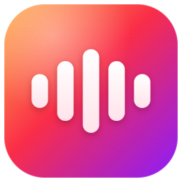
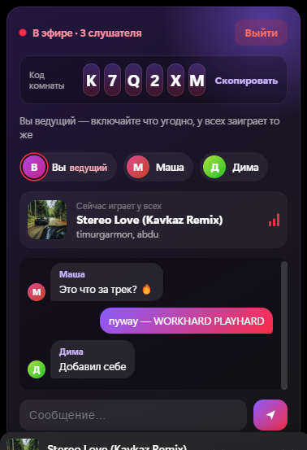
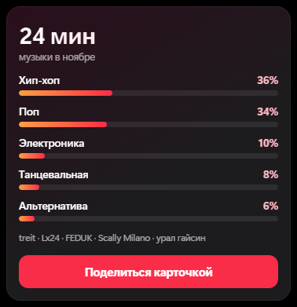
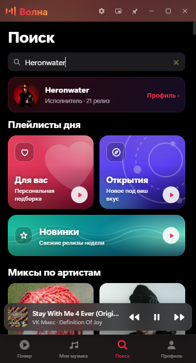
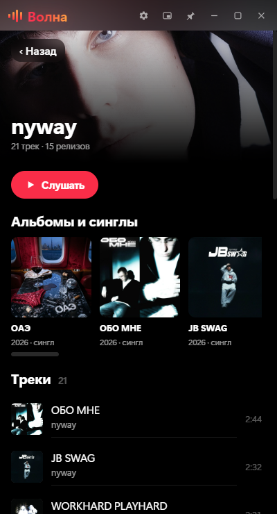
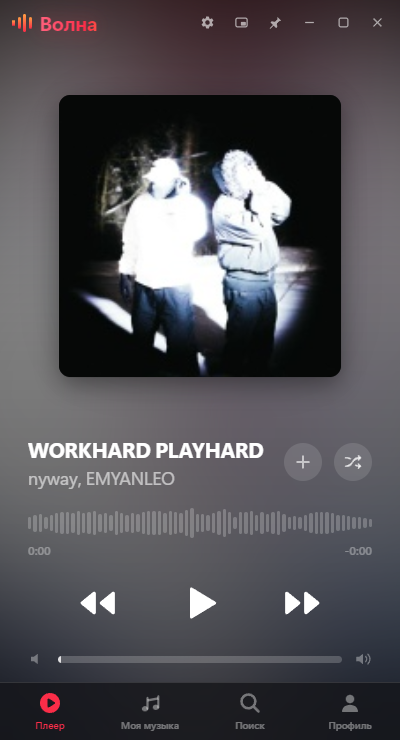

<h1 align="center">Пульс</h1>

<b>Десктоп-плеер для ВК Музыки, в котором музыку можно слушать вместе с друзьями.</b> 
Тёмный интерфейс в стиле iPhone, работает поверх вашего аккаунта ВК.

<a href="../../releases/latest"><b>⬇ Скачать для Windows</b></a>

---

## 🎧 Чего нет больше нигде

### Слушать вместе
Создайте комнату и отправьте другу код из 6 символов. Ведущий включает любые треки, а у всех в комнате они играют одновременно: совпадают и трек, и пауза, и перемотка. Внутри комнаты есть чат.

### Музыкальные профили друзей
* **Совпадение вкусов в процентах.**
* **Общий микс:** ваши общие исполнители вперемешку.
* **Итоги месяца друга:** что и в каких жанрах он добавлял.

### Итоги месяца
Сколько вы слушали и какие жанры любили больше всего. Карточкой можно поделиться в один клик.

### Профили исполнителей
Начните вводить имя исполнителя или название трека, и в поиске появится карточка артиста. По ней открывается его профиль со всеми треками, альбомами и синглами.

 &nbsp; 

---

## ✨ И ещё

* **Плеер:** живой фон из обложки, волна вместо полосы прогресса, свечение в такт басам, виниловый режим.
* **Музыка:** «Моя музыка» с сортировкой, VK Микс, чарт, подборки «Для вас», «Открытия» и «Новинки», перемешивание.
* **Мини-плеер** поверх всех окон и полноэкранный режим.
* **Пульт с телефона:** отсканируйте QR-код — и управляйте музыкой с телефона по Wi-Fi.
* **Горячие клавиши:** работают глобально, назначить можно любую клавишу и боковые кнопки мыши.
* **Discord:** статус «Слушает» с названием трека.
* **Профиль:** статистика прослушивания.
* **Вход и обновления:** вход по QR-коду, автообновление.

## Установка
1. Скачайте `Puls-Setup-*.exe` в разделе [Releases](../../releases/latest).
2. Установите и войдите в ВК, например по QR-коду с телефона.
3. Слушайте.

«Пульс» — неофициальный клиент и не связан с VK.
